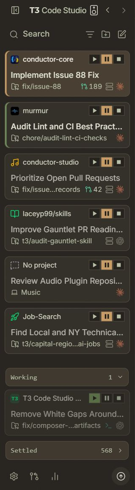
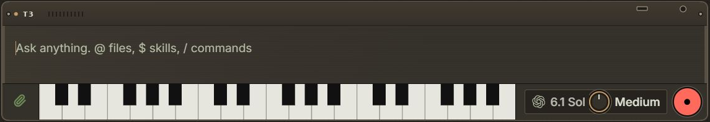
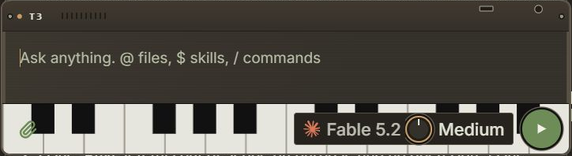

# T3 Code Studio Theme

A dark, music-studio theme for T3 Code. Tape Room's warm brown panels and brass accents, Subtle Moss text and focus colours, a speaker-grille background, and controls borrowed from a recording desk.

## Preview

Screenshots from the current Studio theme in T3 Code Nightly on Windows, using the Tape Room + Subtle Moss palette and off-white piano keys.

**Sidebar.** Native project icon colors, warm brown thread cards, and the play / pause / stop strips. The selected thread has an orange left edge; the unread **Done** thread below it has a green edge. The **Working** and **Settled** shelves appear below the other threads.



**Wide composer.** Three complete piano octaves end on a full B key beside the model and reasoning controls. The attachment and selector panels cover the keyboard behind them. This capture shows the red stop control while an agent is running; submit and steer controls use a green play triangle. Composers wider than 600px and up to 900px show two complete octaves in the same arrangement.



**Condensed composer.** At 600px or less, two full-width octaves sit behind the attachment, model/reasoning, and green play controls, without the surrounding brown control panels.



## What it changes

- **Sidebar:** warm brown rounded thread cards with a play / pause / stop strip. Play lights green while a thread is working, pause brass when idle, stop red when settled. Native project icons keep their colors. On hover or keyboard focus, the transport strip is fully replaced by the native snooze and settle actions, which appear as console-style fast-forward (snooze) and stop (settle) buttons, keeping their original tooltips and behavior. Done or unread threads get a green left edge; the selected thread gets an orange edge instead. Threads with an unsent draft get a yellow tint.
- **Brand:** the app title reads "T3 Code Studio" with a small speaker icon, and the back / forward arrows are plain chevrons.
- **Conversation:** one subtle, uniform grille layer on the chat canvas, sage `INPUT` / `OUTPUT` labels with a small LED, and code blocks styled as rack units. The composer has no blurred glass backdrop or outer shadow to darken the grille underneath it.
- **Composer:** a brushed synth-style top panel with T3 branding, vents, screws, and unlabelled USB/DC sockets; two or three complete octaves of off-white piano keys starting on C, with solid brown attachment and selector panels when the composer is wider than 600px (full-width keys with overlapping controls in smaller composers), a brass knob for the model and reasoning picker, a header LED that turns green with a brass border while focus is inside the composer, a green play triangle for sending, keys that loop an eighth-note trance riff in brass while the focused prompt has text (two A keys an octave apart, held still, with reduced motion), and a red button with a black circle and a pulsing red glow to stop the running agent (glow animation respects reduced motion).
- **Arrangement ruler:** the thread header ends in a numbered bar ruler with beat ticks above the brass line. A playhead follows how far the conversation is scrolled, and the previous / next turn buttons sit side by side at the ruler's left edge.
- **Project dropdowns:** the new-thread project picker and the sidebar project filter look like an iPod playlist: a backlit LCD title bar, numbered tracks, a brass bar with ▶ on the highlighted row, ♪ in place of the current project's number, and a plain thin scrollbar instead of the fader.
- **Usage limits:** each limit bar is an LED ladder. Lit segments show what is left and run green to amber (60%) to red (80%) from left to right, like a DAW meter; used segments stay dark. The pace marker is a brass playhead line.
- **Thread details:** the context meter is a fader that turns brass at 60% and red at 75%.
- **Scrollbars:** a slot with a fader cap. Vertical scrollbars have seven small fader ticks to the left of the cap.
- **Terminal:** warm charcoal background, moss-tinted ivory text, brass cursor.

## Install

1. Download `studio.json`.
2. In T3 Code, open **Settings > Appearance > Import theme** and pick the file.
3. Choose **Studio**.

The JSON includes the CSS. There are no fonts, scripts, or remote assets.

### Set it for a whole environment

With the `t3` CLI on your PATH, run from the repository root:

```
t3 theme set ./studio.json --id studio
```

This publishes the theme to the T3 themes folder and switches connected web and desktop clients to it.

## Editing the theme

Edit `studio.css`, then run (requires Node.js):

```
node scripts/apply-theme.mjs --watch
```

On each save it copies `studio.css` into the `css` field of `studio.json`, checks that the theme file stays under T3's 32 KiB limit, and runs `t3 theme set`, so the open app updates as you edit. Drop `--watch` to apply once, or use `--no-apply` to only sync and check. Other flags, such as `--base-dir <dir>`, go to the local `t3 theme set`.

### Apply on other machines

Add `--remote <host>` (repeatable) to also apply the theme on another machine over SSH, for example one reached through Tailscale:

```
node scripts/apply-theme.mjs --remote laptop
```

The script copies `studio.json` into `~/.t3/userdata/themes/` on that host and runs `t3 theme set studio` there. The host needs:

- Key-based SSH login with no password prompt, so `ssh <host> hostname` works on its own. An alias in `~/.ssh/config` keeps the name short.
- An SSH server. On Windows, enable the built-in **OpenSSH Server**.
- `t3` on its PATH in SSH sessions.
- An existing `~/.t3/userdata/themes/` folder (the default T3 data location). The script does not create it, so if the folder is missing or T3 keeps its data elsewhere, the copy fails with an `scp` error. Create the folder once on that host to fix it.

If one machine fails, the others are still updated and the script exits with an error.

## Files

| File | Purpose |
| --- | --- |
| `studio.json` | The importable theme: color palette plus the CSS. |
| `studio.css` | The same CSS as a separate file, for reading and editing. |
| `scripts/apply-theme.mjs` | Syncs `studio.css` into `studio.json`, checks it, and applies it with `t3 theme set`. |

If you edit `studio.css`, sync it into `studio.json` before importing (`node scripts/apply-theme.mjs --no-apply` does this). T3 refuses theme files over 32 KiB (32,768 bytes), which is why the CSS is minified. Native CSS nesting shares the theme selector while preserving its specificity.

## Limits

- Built and checked on the T3 Code desktop app (Nightly, Windows). The native mobile app and other platforms are untested.
- The theme is CSS only. The transport strip, piano keys, and knob are visual; they do not add new actions.
- Many rules rely on T3's internal markup. A T3 update can stop individual rules from applying; the rest of the theme keeps working.
- Dark appearance only.

## License

MIT. See [LICENSE](LICENSE).
