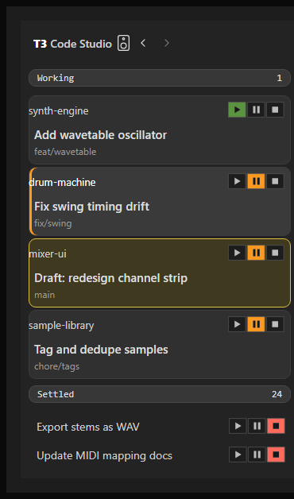
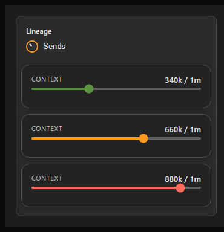

# T3 Code Studio Theme

A dark, music-studio theme for T3 Code. Charcoal panels, a speaker-grille background, and controls borrowed from a recording desk.

## Preview

These images are rendered from the theme's CSS with sample content, not captured from the running app. Spacing and icons in T3 Code will differ slightly, and scrollbars are not shown.

**Conversation and composer.** Grille-mesh background, `INPUT` / `OUTPUT` labels, a rack-unit code block, the piano-key row, the reasoning knob, and the green send button.


**Sidebar.** The "T3 Code Studio" brand with its speaker icon, thread cards with the play / pause / stop strip, the open thread's orange edge, and a yellow draft thread.



**Thread details.** The "Sends" knob and the context fader at green, orange (60%+), and red (75%+).



## What it changes

- **Sidebar:** grey rounded thread cards with a play / pause / stop strip. Play lights green while a thread is working, pause orange when idle, stop red when settled. Threads with an unsent draft get a yellow tint.
- **Brand:** the app title reads "T3 Code Studio" with a small speaker icon, and the back / forward arrows are plain chevrons.
- **Conversation:** grille-mesh background, grey `INPUT` / `OUTPUT` labels with a small LED, and code blocks styled as rack units.
- **Composer:** a piano-key bottom row, a knob for the model and reasoning picker, a green send button, and a red stop button while the agent runs.
- **Turn history:** a horizontal tick strip under the thread title.
- **Thread details:** the context meter is a fader that turns orange at 60% and red at 75%.
- **Scrollbars:** a slot with a fader cap.
- **Terminal:** dark grey background, white text, orange cursor.

## Install

1. Download `studio.json`.
2. In T3 Code, open **Settings > Appearance > Import theme** and pick the file.
3. Choose **Studio**.

The JSON includes the CSS. There are no fonts, scripts, or remote assets.

### Set it for a whole environment

Copy `studio.json` into the T3 themes folder (normally `~/.t3/userdata/themes/`) and run:

```
t3 theme set studio
```

Connected web and desktop clients switch to it.

## Files

| File | Purpose |
| --- | --- |
| `studio.json` | The importable theme: color palette plus the CSS. |
| `studio.css` | The same CSS as a separate file, for reading and editing. |

If you edit `studio.css`, copy its full contents into the `css` field of `studio.json` before importing. T3 limits theme CSS to 20,000 characters, which is why the file is minified.

## Limits

- Built and checked on the T3 Code desktop app (Nightly, Windows). The native mobile app and other platforms are untested.
- The theme is CSS only. The transport strip, piano keys, and knob are visual; they do not add new actions.
- Many rules rely on T3's internal markup. A T3 update can stop individual rules from applying; the rest of the theme keeps working.
- Dark appearance only.

## License

MIT. See [LICENSE](LICENSE).
