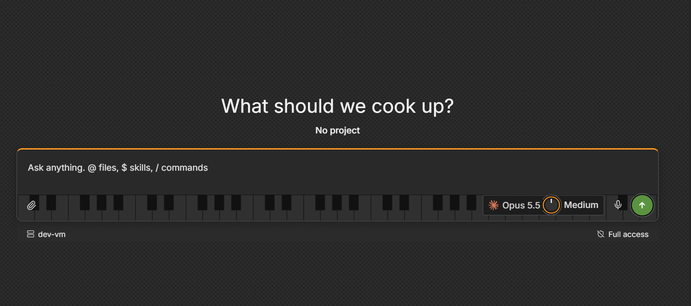
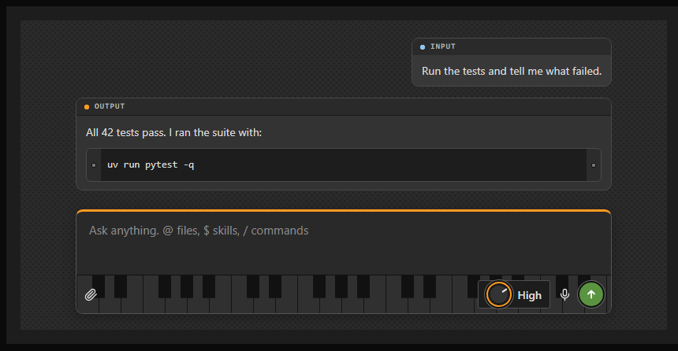

# T3 Code Studio Theme

A dark, music-studio theme for T3 Code. Tape Room's warm brown panels and brass accents, Subtle Moss text and focus colours, a speaker-grille background, and controls borrowed from a recording desk.

## Preview

These images predate the Tape Room + Subtle Moss palette and off-white piano keys.

**New thread.** A screenshot from T3 Code: the grille-mesh background, the "What should we cook up?" heading, and the composer with its piano-key row, reasoning knob, and green send button.



**Sidebar.** A screenshot from T3 Code: the "T3 Code Studio" brand with its speaker icon, chevron arrows, and grey thread cards with the play / pause / stop strip. Pause is lit orange on idle threads, play green on the running thread under **Working**, and stop red on rows under **Settled**. The open thread has an orange left edge, and the **Snoozed** shelf sits between them.


**Conversation.** This image is rendered from the theme's CSS with sample content, not captured from the running app, so spacing and icons differ slightly. `INPUT` / `OUTPUT` labels with LEDs, a rack-unit code block, the model and reasoning picker, and the fader scrollbar on the right edge. The scrollbar is drawn to match, since the render tool cannot show real scrollbars.



## What it changes

- **Sidebar:** warm brown rounded thread cards with a play / pause / stop strip. Play lights green while a thread is working, pause brass when idle, stop red when settled. Threads with an unsent draft get a yellow tint.
- **Brand:** the app title reads "T3 Code Studio" with a small speaker icon, and the back / forward arrows are plain chevrons.
- **Conversation:** one subtle, uniform grille layer on the chat canvas, sage `INPUT` / `OUTPUT` labels with a small LED, and code blocks styled as rack units. The composer has no blurred glass backdrop or outer shadow to darken the grille underneath it.
- **Composer:** a brushed synth-style top panel with T3 branding, vents, screws, and unlabelled USB/DC sockets; off-white piano keys starting on C, with solid brown attachment and selector panels when the composer is wider than 600px (full-width keys with overlapping controls in smaller composers), a brass knob for the model and reasoning picker, a green play triangle for sending, and a red button with a black circle and a pulsing red glow to stop the running agent (glow animation respects reduced motion).
- **Turn history:** a horizontal tick strip under the thread title.
- **Thread details:** the context meter is a fader that turns brass at 60% and red at 75%.
- **Scrollbars:** a slot with a fader cap.
- **Terminal:** warm charcoal background, moss-tinted ivory text, brass cursor.

## Install

1. Download `studio.json`.
2. In T3 Code, open **Settings > Appearance > Import theme** and pick the file.
3. Choose **Studio**.

The JSON includes the CSS. There are no fonts, scripts, or remote assets.

### Set it for a whole environment

Copy `studio.json` into the T3 themes folder (normally `~/.t3/userdata/themes/`) and run:

```
t3 theme set studio
```

Connected web and desktop clients switch to it.

## Files

| File | Purpose |
| --- | --- |
| `studio.json` | The importable theme: color palette plus the CSS. |
| `studio.css` | The same CSS as a separate file, for reading and editing. |

If you edit `studio.css`, copy its full contents into the `css` field of `studio.json` before importing. T3 limits theme CSS to 20,000 characters, which is why the file is minified. Native CSS nesting shares the theme selector while preserving its specificity.

## Limits

- Built and checked on the T3 Code desktop app (Nightly, Windows). The native mobile app and other platforms are untested.
- The theme is CSS only. The transport strip, piano keys, and knob are visual; they do not add new actions.
- Many rules rely on T3's internal markup. A T3 update can stop individual rules from applying; the rest of the theme keeps working.
- Dark appearance only.

## License

MIT. See [LICENSE](LICENSE).
